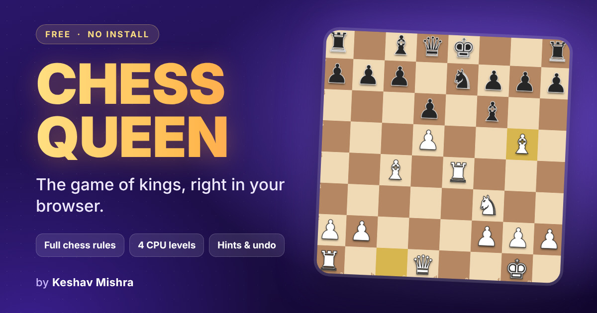

<div align="center">

# ♛ Chess Queen ♛

### ♟️ The Game of Kings, Right in Your Browser 👑

**Free • Instant • No Install • Phone, Tablet & Desktop**

<br>

<a href="https://mkeshav872-png.github.io/Chess-Queen/">
  
</a>

<br><br>

<a href="https://mkeshav872-png.github.io/Chess-Queen/">
  
</a>

<br><br>


</div>

---

## 👋 About the Game

**Chess Queen** ek full chess game hai jo seedha browser mein chalta hai. 🎉
Koi download nahi, koi install nahi, bas link kholo aur khelna shuru karo!

Computer ke saath khelo ya phone dost ko pass kar do. Chess ka **engine bilkul scratch se likha gaya hai**, aur uska rule-checking standard perft tests se verify kiya gaya hai. 🧠

---

## 🎮 Play Now

| 🌍 Game | 👉 Link |
|:---:|:---:|
| **Chess Queen** | [**▶ Click Here to Play 🚀**](https://mkeshav872-png.github.io/Chess-Queen/) |

> 💡 **Tip:** Phone ko landscape ya portrait, dono mein khel sakte ho. Tablet aur desktop par bhi poora mazaa aayega. 📱💻

---

## ✨ Features

| | Feature | Details |
|:-:|:--|:--|
| 📜 | **Full Chess Rules** | Castling, en passant, pawn promotion, check, checkmate aur stalemate |
| 🤝 | **Draws Properly Handled** | Threefold repetition, 50-move rule aur insufficient material |
| 🤖 | **Play Your Way** | Computer ke khilaf ya dost ke saath (pass the device) |
| 🎚️ | **4 Computer Levels** | Easy, Medium, Hard, Pro |
| ⚪⚫ | **Choose Your Side** | White, Black ya random |
| 💡 | **Hint, Undo & Flip Board** | Jab zaroorat ho tab use karo |
| 🎬 | **Polished Feel** | Smooth piece animations, move highlights, capture effects aur sound |
| 😎 | **Emoji Reactions & Quick Chat** | Khel ke beech mein mazedar reactions |
| 🎨 | **6 Themes & 2 Piece Styles** | Apni pasand ka look chuno |
| 💾 | **Remembers Settings** | Tumhari settings device par save rehti hain |
| 📱 | **Works Everywhere** | Phone, tablet aur desktop, portrait ya landscape |

---

## 🎯 How to Play

1. 👆 Kisi piece par tap karo, phir highlighted square par tap karke move karo
2. 👑 Opponent ke king ko **checkmate** karo aur jeet jao
3. 💡 **Hint** ke liye, ↩ **Undo** ke liye aur ⇅ **Flip board** ke liye buttons use karo
4. 🤝 Game draw ho sakta hai stalemate, repetition, 50-move rule ya kam pieces bachne par

---

## ✅ Tested & Reliable

Move generator standard **perft** test positions pass karta hai, jo chess engines verify karne ke liye use hote hain. Isme castling, en passant, promotion aur pins jaise tricky cases bhi shamil hain. Matlab chess ke rules sahi tarike se implement hain. 🏆

---

## 🧰 Built With

| Technology | Use |
|:-----------|:----|
| 🟧 **HTML5** | Game ka structure |
| 🟦 **CSS3** | Design, themes, responsive layout |
| 🟨 **Vanilla JavaScript** | Game logic aur chess engine (scratch se) |
| 🔊 **Web Audio API** | Sound live generate hoti hai, koi audio file nahi |
| 🌐 **GitHub Pages** | Free hosting |

---

## 📁 Project Structure

```
Chess-Queen/
│
├── 📄 index.html      ← Poora game (single file)
├── 🖼️ Chess-Queen-thumbnail.jpg ← Game thumbnail
├── 📜 LICENSE         ← MIT License
└── 📘 README.md       ← Ye file
```

> ✅ Poora game ek hi `index.html` mein hai. Kuch build ya install nahi karna padta.

---

## 🚀 Run It Yourself

```bash
# 1️⃣ Repository clone karo
git clone https://github.com/mkeshav872-png/Chess-Queen.git

# 2️⃣ Folder ke andar jao
cd Chess-Queen

# 3️⃣ index.html ko browser mein kholo (double click kaafi hai)
```

---

## 🎲 More Games

<div align="center">

| 🎲 Game | 📝 About | 👉 Play |
|:---:|:---|:---:|
| **Ludo King** | Classic Ludo, 2 se 4 players | [**▶ Play Now**](https://mkeshav872-png.github.io/Lodu-King/) |

</div>

---

## 🤝 Let's Connect

<div align="center">

[](https://mkeshav872-png.github.io/Portfolio/)
[](https://github.com/mkeshav872-png)

</div>

---

## 📄 License

Ye project [MIT License](./LICENSE) ke under hai. 🙏

---

<div align="center">

### ⭐ Game pasand aaya to is repository ko Star zaroor karo! ⭐

**Made with ❤️ by [Keshav Mishra](https://github.com/mkeshav872-png)**

</div>
